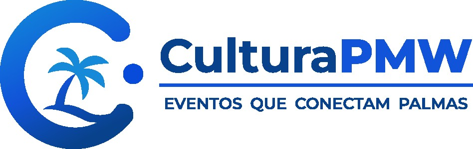

 <div align="center">



# 🎭 CulturaPMW

### Agenda Cultural, Esportiva e de Lazer de Palmas – TO

[](https://vuejs.org/)
[](https://www.typescriptlang.org/)
[](https://vite.dev/)
[](https://supabase.com/)
[](https://vercel.com/)

**Conectando produtores culturais e o público de Palmas em um só lugar.** 🌴

[🌐 Acessar aplicação](https://cultura-pmw.vercel.app/) · [📂 Repositório](https://github.com/thiagopietrobon/CulturaPMW)

</div>

---

## 📖 Sobre o projeto

O **CulturaPMW** é uma plataforma web desenvolvida para centralizar, organizar e divulgar eventos culturais, esportivos e de lazer realizados em **Palmas – Tocantins**.

A proposta é facilitar o acesso da população às atividades disponíveis na cidade, reduzindo a dispersão de informações em diferentes redes sociais e canais de divulgação.

A plataforma também oferece ferramentas para produtores de eventos cadastrarem e gerenciarem suas publicações, enquanto administradores são responsáveis pela aprovação de produtores e moderação do conteúdo.

O projeto foi desenvolvido no contexto acadêmico da disciplina de Modelagem de Software, aplicando conceitos de arquitetura, orientação a objetos, banco de dados e desenvolvimento de aplicações web.

## 🌐 Aplicação publicada

A aplicação está hospedada na Vercel e pode ser acessada pelo endereço:

**[Acessar CulturaPMW](https://cultura-pmw.vercel.app/)**

---

## ✨ Funcionalidades

A plataforma possui três áreas principais, organizadas de acordo com o perfil de acesso.

### 🎟️ Público geral

- Visualização de eventos disponíveis em Palmas.
- Feed cronológico de eventos.
- Atalhos para eventos de hoje e do próximo final de semana.
- Pesquisa por título, descrição, endereço, categoria, região e produtor.
- Filtros combinados por categorias, regiões e gratuidade.
- Página de detalhes com informações completas do evento.
- Visualização de perfis públicos dos produtores.
- Acesso a links externos de ingressos e divulgação.
- Integração com Google Maps e Waze para localização dos eventos.

### 🎤 Produtores de eventos

- Cadastro de produtores com validação administrativa.
- Autenticação e recuperação de senha.
- Acompanhamento da situação do cadastro.
- Publicação, edição e exclusão dos próprios eventos.
- Upload de imagens para divulgação.
- Cadastro de localização e endereço dos eventos.
- Consulta de endereço por CEP utilizando ViaCEP.
- Gerenciamento de links externos.
- Acompanhamento da situação dos eventos publicados.

### 🛡️ Administradores

- Painel administrativo com indicadores gerais.
- Aprovação e reprovação de solicitações de cadastro.
- Suspensão e reativação de produtores.
- Gerenciamento de produtores cadastrados.
- Moderação, edição e remoção de eventos.
- Cadastro, edição e exclusão de categorias.
- Controle das permissões de acesso à área administrativa.

### ⏱️ Gerenciamento da situação dos eventos

O sistema também contempla o controle do ciclo de vida dos eventos.

- Atualização da situação de eventos encerrados.
- Identificação de eventos concluídos.
- Ocultação de eventos encerrados há mais de 24 horas na consulta pública.
- Preservação dos registros para consulta e gerenciamento interno.

---

## 🎨 Experiência de utilização

A interface foi desenvolvida para oferecer uma experiência simples e consistente, considerando os diferentes perfis de usuários.

Entre os recursos visuais e de interação estão:

- Interface responsiva.
- Tema claro e escuro.
- Componentes reutilizáveis.
- Estados de carregamento, erro e ausência de resultados.
- Formulários organizados por etapas e funcionalidades.
- Navegação adaptada às áreas pública, administrativa e do produtor.

---

## 🏗️ Tecnologias utilizadas

| Tecnologia | Aplicação no projeto |
|---|---|
| [Vue.js 3](https://vuejs.org/) | Construção da interface e componentes |
| [TypeScript](https://www.typescriptlang.org/) | Tipagem estática e organização do código |
| [Vite](https://vite.dev/) | Ferramenta de desenvolvimento e build |
| [Vue Router](https://router.vuejs.org/) | Gerenciamento de rotas e navegação |
| [Supabase](https://supabase.com/) | Backend, banco de dados, autenticação e armazenamento |
| [PostgreSQL](https://www.postgresql.org/) | Banco de dados relacional |
| [ViaCEP](https://viacep.com.br/) | Consulta de endereços por CEP |
| [Vercel](https://vercel.com/) | Hospedagem e publicação da aplicação |

### Arquitetura

O projeto utiliza uma organização baseada na separação de responsabilidades, com componentes, modelos de domínio, serviços, composables e visualizações.

A modelagem orientada a objetos está presente em `src/models/`, enquanto os serviços centralizam as operações de comunicação com o Supabase e APIs externas.

O Vue 3 utiliza a Composition API para organizar a lógica das funcionalidades, e o Vue Router controla a navegação entre as áreas públicas e protegidas.

---

## 📂 Estrutura do projeto

```text
CulturaPMW/
├── docs/                       # Documentação funcional e técnica
├── scripts/                    # Scripts auxiliares
├── src/
│   ├── assets/
│   │   ├── svg/                # Imagens e recursos gráficos
│   │   └── styles/             # Estilos globais
│   ├── components/
│   │   ├── eventos/            # Componentes de eventos
│   │   ├── formularios/        # Componentes de formulários
│   │   ├── layout/             # Estrutura e navegação
│   │   └── produtor/           # Componentes do produtor
│   ├── composables/            # Lógica reutilizável
│   ├── models/                 # Modelos de domínio
│   ├── router/                 # Configuração das rotas
│   ├── services/               # Serviços e integrações
│   └── views/
│       ├── admin/              # Área administrativa
│       ├── auth/               # Autenticação
│       ├── produtor/           # Área do produtor
│       └── public/             # Área pública
├── supabase/
│   └── migrations/             # Migrações do banco de dados
├── .env.example                # Exemplo de variáveis de ambiente
├── package.json
├── vercel.json
└── README.md
```

---

## 🗄️ Banco de dados e segurança

O Supabase é utilizado como infraestrutura de backend, oferecendo os recursos necessários para autenticação, persistência de dados e armazenamento de arquivos.

A estrutura contempla:

- **PostgreSQL:** armazenamento das informações da plataforma.
- **Supabase Auth:** autenticação e gerenciamento de contas.
- **Supabase Storage:** armazenamento das imagens dos eventos.
- **Row Level Security (RLS):** controle de acesso aos dados.
- **Views e funções SQL:** consultas públicas e operações específicas do sistema.

As permissões são definidas de acordo com os perfis de acesso. Produtores gerenciam seus próprios conteúdos, enquanto administradores possuem permissões específicas para moderação e gerenciamento da plataforma.

### Migrações

As alterações estruturais do banco de dados são organizadas em arquivos SQL na pasta `supabase/migrations/`.

| Migração | Responsabilidade |
|---|---|
| `202611180001_admin_area.sql` | Estrutura da área administrativa |
| `202611180002_rf01_contas_produtor.sql` | Cadastro e gerenciamento de contas de produtores |
| `202611180003_verificar_documento_produtor.sql` | Verificação de documentos de produtores |
| `202611180004_rf06_localizacao.sql` | Recursos de localização dos eventos |
| `202611180005_rf02_gerenciar_eventos.sql` | Gerenciamento de eventos |
| `202611180006_rf09_situacao_eventos.sql` | Controle da situação dos eventos |

As migrações devem ser aplicadas respeitando suas dependências e a estrutura inicial do banco de dados.

---

## 🚀 Executando localmente

### Pré-requisitos

- [Node.js](https://nodejs.org/) compatível com o Vite 8.
- npm.
- Projeto configurado no Supabase.

### 1. Clone o repositório

```bash
git clone https://github.com/thiagopietrobon/CulturaPMW.git
cd CulturaPMW
```

### 2. Instale as dependências

```bash
npm install
```

### 3. Configure as variáveis de ambiente

Crie um arquivo `.env` na raiz do projeto, utilizando o `.env.example` como referência.

```env
VITE_SUPABASE_URL=https://seu-projeto.supabase.co
VITE_SUPABASE_ANON_KEY=sua-chave-publica
```

Preencha as variáveis com as informações do seu projeto Supabase.

> [!IMPORTANT]
> Utilize somente a chave pública apropriada para o frontend. Nunca exponha chaves secretas ou `service_role` no código cliente ou em arquivos versionados.

### 4. Inicie o servidor de desenvolvimento

```bash
npm run dev
```

A aplicação ficará disponível no endereço indicado pelo Vite, normalmente:

`http://localhost:5173`

### 5. Gere a versão de produção

Para verificar e gerar a versão de produção:

```bash
npm run build
```

Para visualizar a versão compilada localmente:

```bash
npm run preview
```

---

## ☁️ Publicação

A aplicação está publicada na **Vercel**, com integração ao repositório GitHub.

O arquivo `vercel.json` contém a regra de reescrita necessária para que as rotas da aplicação Vue Router funcionem corretamente ao acessar diretamente uma página ou atualizar o navegador.

As variáveis de ambiente do Supabase também devem ser configuradas nas definições do projeto na Vercel.

**Aplicação:** [https://cultura-pmw.vercel.app/](https://cultura-pmw.vercel.app/)

---

## 📚 Documentação

O projeto possui documentos complementares na pasta [`docs/`](docs/), incluindo especificações funcionais, decisões técnicas e orientações de configuração.

| Documento | Descrição |
|---|---|
| [ADMIN_SETUP.md](docs/ADMIN_SETUP.md) | Configuração inicial da área administrativa |
| [RF01_CADASTRO_PRODUTOR.md](docs/RF01_CADASTRO_PRODUTOR.md) | Cadastro e gerenciamento de produtores |
| [RF02_GERENCIAMENTO_EVENTOS.md](docs/RF02_GERENCIAMENTO_EVENTOS.md) | Gerenciamento de eventos |
| [RF03_RF04_RF05_AREA_PUBLICA.md](docs/RF03_RF04_RF05_AREA_PUBLICA.md) | Funcionalidades da área pública |
| [RF06_LOCALIZACAO.md](docs/RF06_LOCALIZACAO.md) | Recursos de localização |
| [RF09_SITUACAO_EVENTOS.md](docs/RF09_SITUACAO_EVENTOS.md) | Situação e encerramento de eventos |
| [LOGIN_UNIFICADO_20-11.md](docs/LOGIN_UNIFICADO_20-11.md) | Autenticação unificada |
| [TEMA_ESCURO_E_ANIMACOES.md](docs/TEMA_ESCURO_E_ANIMACOES.md) | Tema escuro e animações |

---

## 👥 Equipe de desenvolvimento

| Integrante | Participação |
|---|---|
| **Thiago Henrique B. Pietrobon** | Lider do projeto |
| **Flávio J. L. Varnier** | Engenheiro de software • UX/UI |
| **Anthonny C. S. Patrocinio** | Engenheiro de software |
| **Pedro Arthur Souza Napp** | Desenvolvimento • UX/UI |
| **Lucas Cardoso Marinho** | Engenheiro de software |
| **Gabriel Oliveira Medeiros** | Desenvolvimento • QA |

---

<div align="center">

🎓 **Projeto acadêmico — Modelagem de Software**

Desenvolvido em Palmas, Tocantins.

**CulturaPMW — A cultura da cidade em um só lugar.** 🌴

</div>